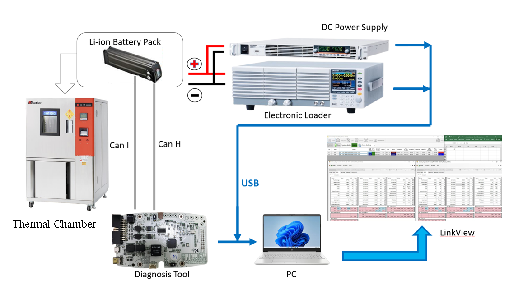

# 25°C Lithium-Ion Battery Cycling Experimental Dataset

## 1. Overview
This dataset provides experimental cycling records from **four lithium-ion battery packs tested at an ambient temperature of 25°C**, along with corresponding Hybrid Pulse Power Characterization (HPPC) and Reference capacity test data.
The dataset can be used for battery performance analysis, State of Health (SOH) estimation, and battery degradation research.
Each battery was originally scheduled for approximately 500 charge-discharge cycles. However, due to missing experimental records, **the dataset does not contain a complete, continuous sequence of Cycles 1–500**.
The original measurement values are preserved. Missing cycles are not reconstructed through interpolation, imputation, or padding, and the original cycle numbers are not reassigned.
**Data completeness verification date: November 6, 2026**

## 2. Experimental Setup
| Parameter | Description |
| --- | --- |
| Battery type | Lithium-ion battery pack |
| Battery configuration | 13S2P |
| Nominal capacity | 6.2 Ah |
| Ambient temperature | 25°C |
| Number of batteries | 4 |
| Planned cycling duration | Approximately 500 cycles |
| HPPC test interval | Approximately every 50 cycles |
| Reference test interval | Approximately every 50 cycles |

### Experimental Setup Diagram

*Figure 1. Experimental setup for lithium-ion battery charging, discharging, and data acquisition.*

### Battery Identification
| Channel | Battery ID |
| --- | --- |
| Ch1 | 61-7000 |
| Ch2 | 61-8000 |
| Ch3 | 54-5000 |
| Ch4 | 62-3000 |

Battery identification was verified using the `BMS_CustomerSN3` and `BMS_CustomerSN4` fields in the CSV files, together with the mapping shown above.

## 3. Experimental Procedures
### Random Discharge Cycling
- Approximately 500 charge-discharge cycles were originally planned for each battery pack.
- For each discharge segment, the current was randomly selected from **4.0, 4.5, 5.0, 5.5, and 6.0 A**.
- Each segment consisted of **300 seconds of discharge followed by 5 seconds of rest**.
- The discharge segments were repeated until **SOC fell below 20%**.
- After the discharge process ended, the battery pack rested and was then recharged.
**A 305-second discharge/rest segment is not a complete charge-discharge cycle.** The original cycle numbers in the dataset are retained; the segments should not be counted as separate full cycles.
### Reference Test
- The battery pack was discharged at a fixed current of **6 A**.
- Discharge ended when **SOC fell below 20%**.
- The battery pack rested and was then recharged.
### HPPC Test
- Hybrid Pulse Power Characterization (HPPC) tests were used to evaluate battery internal impedance.
- The analysis is based on applied current pulses and the corresponding voltage responses.
HPPC and Reference tests were planned at approximately **50-cycle intervals** during the cycling experiment. The available records may be incomplete, as detailed below. Test-session labels follow the original experimental filenames and may differ from the `BMS_CycleCount` values recorded within a file.

## 4. Dataset Structure
```text
Li-ion_Battery_Data/
├── 25degree/
│   ├── Random/
│   │   ├── Ch1/
│   │   │   └── Cycle_XXX.csv
│   │   ├── Ch2/
│   │   │   └── Cycle_XXX.csv
│   │   ├── Ch3/
│   │   │   └── Cycle_XXX.csv
│   │   └── Ch4/
│   │       └── Cycle_XXX.csv
│   ├── HPPC/
│   │   ├── Ch1/
│   │   │   └── Ch1_CycleXXX/
│   │   │       └── ...
│   │   ├── Ch2/
│   │   ├── Ch3/
│   │   └── Ch4/
│   └── Reference/
│       ├── Ch1/
│       │   └── Ch1_CycleXXX/
│       │       └── ...
│       ├── Ch2/
│       ├── Ch3/
│       └── Ch4/
├── README.md
└── LICENSE
```
Directory descriptions:
- **25degree/Random:** Random discharge cycling records, organized by battery channel and cycle.
- **25degree/HPPC:** Current-pulse and voltage-response records for internal impedance evaluation, organized by battery channel and test session.
- **25degree/Reference:** Fixed-current Reference test records, organized by battery channel and test session.
**A single HPPC or Reference test session may contain multiple measurement files**, stored together in its `ChX_CycleXXX/` directory. The cycle number in that directory name is the experimental filename label; the actual BMS cycle values are recorded in `BMS_CycleCount` within the measurement files.

## 5. Data Availability and Completeness
### 5.1 Cycling Data Summary
The cycling dataset currently contains **1,705 CSV files** across the four batteries.

| Battery ID | Number of Files | Available Cycle Range | Available Cycles Within 1–500 | Missing Cycles Within 1–500 |
| --- | --- | --- | --- | --- |
| 61-7000 | 412 | 21–498 | 412 | 88 |
| 61-8000 | 433 | 21–504 | 429 | 71 |
| 54-5000 | 417 | 21–512 | 405 | 95 |
| 62-3000 | 443 | 21–505 | 438 | 62 |
| **Total** | **1,705** | — | **1,684** | **316** |

Notes:
- Cycles 1–500 are used as the reference range for completeness analysis.
- A total of 21 available files have cycle numbers greater than 500 and are retained in the dataset.
- A missing cycle indicates that no corresponding file is available in the current dataset. It does not necessarily mean that the experiment was not performed.
- The total size of the cycling data is **7,530,716,998 bytes**, excluding HPPC, Reference, and documentation files.
### 5.2 Missing Cycle Numbers
The following table lists the missing cycle numbers within Cycles 1–500 for each battery.

| Battery ID | Missing Cycles |
| --- | --- |
| **61-7000** | 1–20, 65–69, 116–118, 128–144, 164–167, 198–200, 217–221, 247–253, 263, 273–275, 312–315, 359–362, 406–409, 453–458, 499–500 |
| **61-8000** | 1–20, 61, 66–70, 116–118, 164–167, 198–199, 216–220, 250–257, 266, 276–278, 314–318, 363–366, 410–413, 457–462 |
| **54-5000** | 1–20, 25, 66–69, 117–119, 166–169, 214–217, 237–247, 266–269, 277–278, 314–318, 362–369, 398–418, 461–468 |
| **62-3000** | 1–20, 25–26, 60, 72–75, 122–125, 170–174, 219–222, 240, 268–271, 316–319, 364–367, 409–413, 459–462 |

**Important:** When constructing time-series datasets across multiple cycles or training predictive models, the original cycle numbers should be preserved. Records separated by missing cycles should not automatically be treated as consecutive cycling observations.

## 6. CSV Data Description
The cycling CSV files generally use UTF-8 with BOM encoding, comma-separated values, and contain 55 columns.
The main variables are listed below.

| Column | Description |
| --- | --- |
| `DateTime` | Recorded timestamp; some files may contain AM/PM notation or timestamps with only minute-level resolution |
| `BMS_CycleCount` | Cycle number reported by the BMS |
| `BMS_PackVoltage` | Raw battery pack voltage reported by the BMS |
| `BMS_PackCurrent` | Raw battery pack current reported by the BMS, including its sign |
| `BMS_AvgCurrent` | Average current reported by the BMS |
| `BMS_Temp1`, `BMS_Temp2` | Battery temperature sensor readings |
| `BMS_MOSTemp1`, `BMS_MOSTemp2` | MOS-related temperature sensor readings |
| `BMS_FCC` | Full Charge Capacity reported by the BMS |
| `BMS_StateOfHealth` | State of Health reported by the BMS |
| `BMS_RSOC`, `BMS_ASOC` | State of Charge-related values reported by the BMS |
| `BMS_CellVolt1`–`BMS_CellVolt14` | Individual cell voltage-related fields |
| `BMS_CustomerSN1`–`BMS_CustomerSN8` | Battery identification-related fields |

### Measurement Values and Units
No unit conversions or numerical rounding were applied to the voltage, current, temperature, or capacity values during dataset preparation.
Some column headers do not explicitly specify measurement units. Users should verify the relevant BMS or measurement equipment specifications before interpreting the values, particularly the current sign convention and the active cell voltage channels.
Additional considerations:
- `BMS_FCC` is a BMS-estimated capacity value and should not be treated as equivalent to an independently measured Reference capacity.
- `BMS_StateOfHealth` is the SOH value reported by the BMS. It should be distinguished from SOH calculated using the ratio of FCC to nominal capacity.
- The dataset preserves the original columns without recalculating or overwriting these values.

## 7. HPPC and Reference Test Data
HPPC and Reference tests were originally planned at approximately 50-cycle intervals. However, the available experimental records may be incomplete.
### 7.1 File Summary
| Battery ID | Channel | HPPC Files | Reference Files |
| --- | --- | --- | --- |
| 61-7000 | Ch1 | 21 | 19 |
| 61-8000 | Ch2 | 22 | 19 |
| 54-5000 | Ch3 | 12 | 19 |
| 62-3000 | Ch4 | 10 | 18 |
| **Total** | — | **65** | **75** |

The HPPC and Reference datasets contain:
- **140 measurement files**
- **30 HPPC test session directories**
- **36 Reference test session directories**
- **Total size: 1,016,053,667 bytes**
**Note:** The number of test sessions is not necessarily equal to the number of measurement files. A single HPPC or Reference test session may contain multiple files.
### 7.2 Available Test Sessions
The following table lists the identified test session numbers.

| Battery ID | HPPC Test Sessions | Reference Test Sessions |
| --- | --- | --- |
| 61-7000 | 2, 51, 101, 151, 201, 251, 301, 351, 401, 451 | 50, 150, 200, 250, 300, 350, 400, 450, 500 |
| 61-8000 | 2, 51, 101, 151, 201, 251, 301, 351, 401, 451 | 50, 150, 200, 250, 300, 350, 400, 450, 500 |
| 54-5000 | 251, 301, 351, 401, 451 | 50, 150, 200, 250, 300, 350, 400, 450, 500 |
| 62-3000 | 2, 51, 101, 151, 201 | 50, 150, 200, 250, 300, 350, 400, 450, 500 |

Multiple measurement files belonging to the same test session are stored in the same directory.
For example, `25degree/Reference/Ch1/Ch1_Cycle050/` may contain multiple Reference measurement files rather than a single file.

## 8. Known Data Limitations
Users should consider the following limitations before analyzing the dataset.
### 8.1 Discontinuous Cycles and Timestamps
Some cycles are missing, and long interruptions may occur within individual cycle files.
Examples:
- `25degree/Random/Ch1/Cycle_498.csv`: Maximum interval between adjacent timestamps is 245,607 seconds.
- `25degree/Random/Ch4/Cycle_250.csv`: Maximum interval between adjacent timestamps is 432,982 seconds.
Therefore, the dataset should not be assumed to contain continuous, uniformly sampled time-series records.
### 8.2 Limited Timestamp Resolution
For example, `25degree/Random/Ch3/Cycle_250.csv` contains 15,866 records but only 272 distinct timestamp strings.
Identical timestamps do not necessarily indicate duplicate records. Other measurement fields and recording conditions should be considered before removing any observations.
### 8.3 Missing or Invalid Values
Examples of identified issues include:
- `25degree/Random/Ch3/Cycle_250.csv`: 5 records contain invalid FCC values.
- `25degree/Random/Ch3/Cycle_279.csv`: 7 records contain missing battery identification values.
These files are retained in the dataset, and missing values have not been artificially filled.
### 8.4 Zero-Voltage Records
Some records contain voltage values of zero.
Such values should be evaluated together with equipment and communication status information and should not automatically be interpreted as the battery pack physically reaching zero volts.
### 8.5 Ambient Temperature vs. Measured Battery Temperature
The specified 25°C refers to the experimental ambient temperature, not a constant battery temperature throughout all charge-discharge operations.
The measured battery temperature may increase during operation. For example, a temperature value of 40.2 was observed in sampled records.
### 8.6 Potential Timestamp Ordering Issues
Some historical records were concatenated according to source file path order without necessarily applying chronological sorting or duplicate removal.
Researchers requiring strictly chronological data should independently verify the timestamp order and document any preprocessing procedures.
### Recommendations for Data Use
Before performing model training or data analysis, users are advised to verify:
- Continuity of cycle numbers.
- Timestamp resolution, ordering, and sampling intervals.
- Missing, invalid, or abnormal measurement values.
- Suitability of BMS-estimated FCC and SOH for the intended research application.
- Consistency of preprocessing procedures across different batteries.
If filtering, sorting, duplicate removal, interpolation, normalization, or other preprocessing steps are applied, the original records should be preserved and the processing procedures clearly documented.

## 9. License
This dataset is released under the [MIT License](LICENSE).

## 10. Maintainer
**SDMPLab**
Department of Mechanical Engineering  
National Central University, Taiwan
